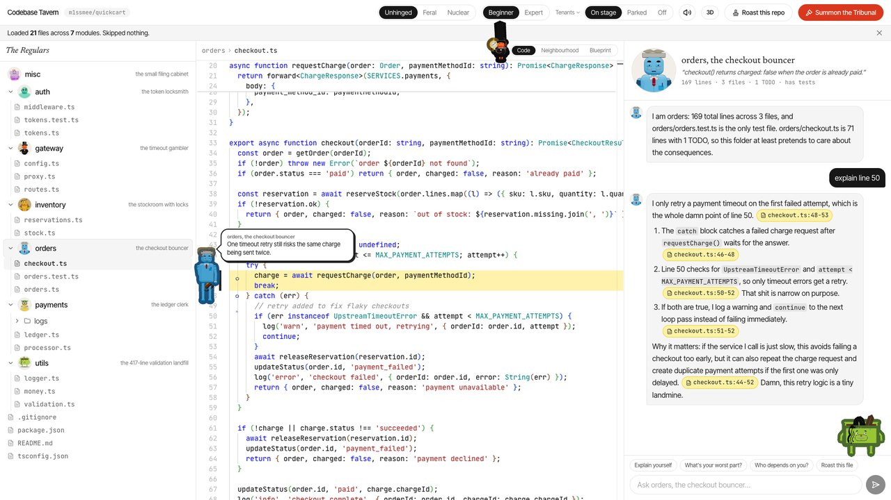
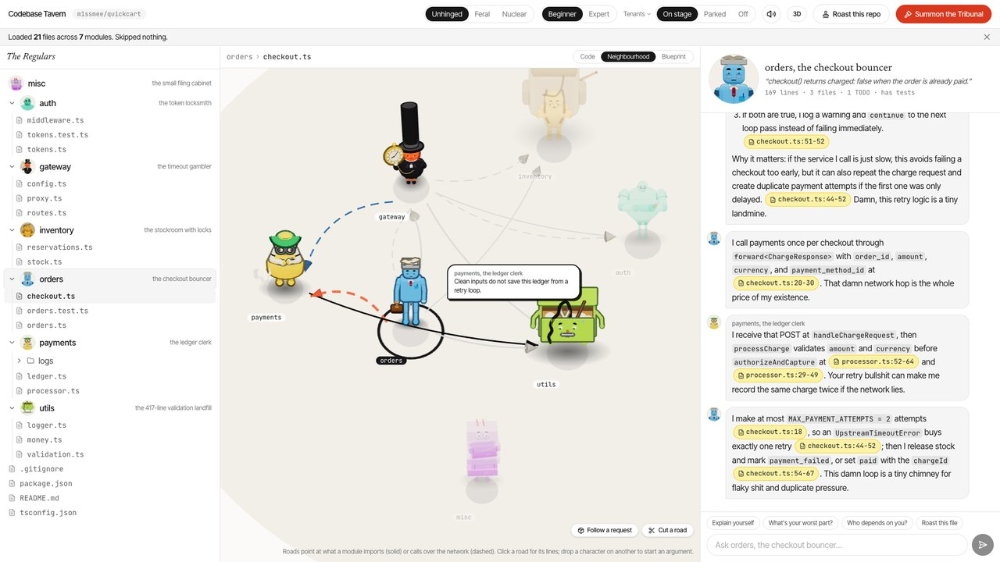
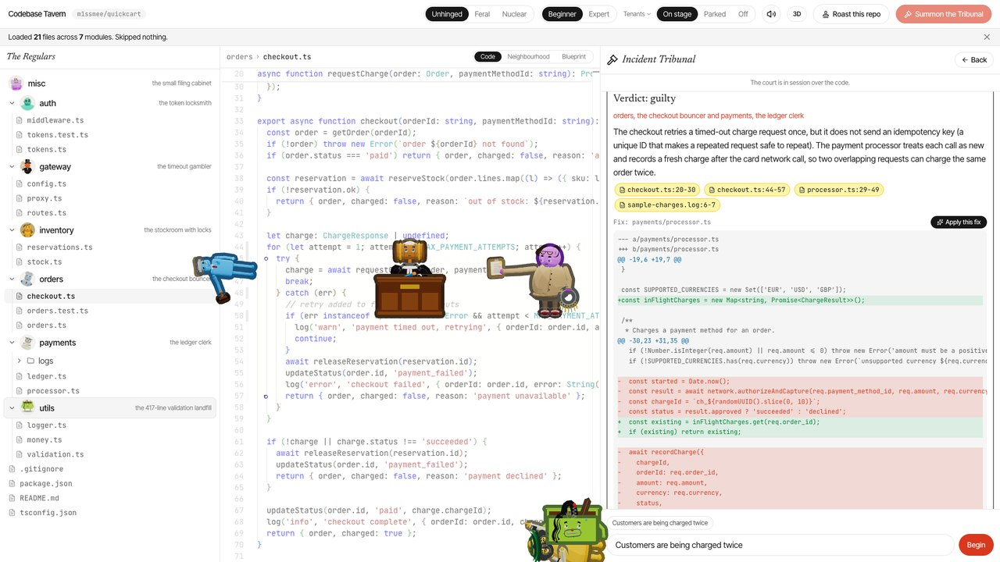
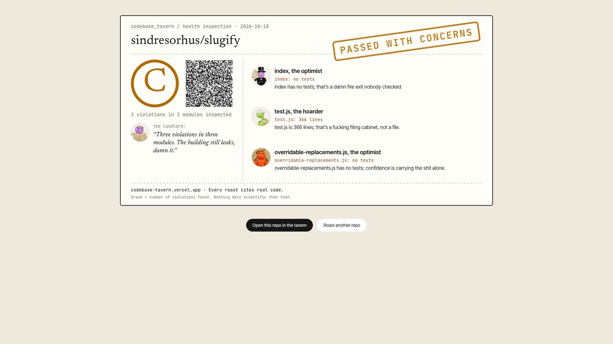

# Codebase Tavern

Paste a GitHub link and every module of the repo becomes a character: it explains its own code, cites the exact lines, and argues with the others about who caused your bug.

**Live:** https://codebase-tavern.vercel.app



## Try it

- **Your repo:** paste a public GitHub link on the landing page, or upload a zip.
- **The demo, no AI needed:** open https://codebase-tavern.vercel.app/tavern?demo=1. It loads the sample repo (`m1ssmee/quickcart`, a small checkout service with a double-charge bug) with a saved cast, a saved argument and a saved Tribunal. Ask orders to "explain line 50", drag orders onto payments in the Neighbourhood, then click Summon the Tribunal and pick "Customers are being charged twice".

## What it does

- **Cited answers.** Ask any module a question. Every claim cites `[path:line]`; the cited lines light up and the character walks over and points at them.
- **Arguments.** Drag one character onto another and they argue, using only their real imports and calls.
- **The Incident Tribunal.** Describe a bug. Suspects are picked from the import graph, argue in turns, and the Judge names the culprits, gives the root cause in plain words and proposes a fix diff that must apply to the real file.
- **What if.** Apply the fix (or any change) and watch it ripple through the modules that depend on it.
- **Neighbourhood and Blueprint.** A map of who imports or calls whom, with a "Follow a request" walk-through; a guided diagram tour of the architecture.
- **Roast card.** A shareable health-inspection notice for a repo, signed so the grades can't be edited.
- **Beginner and Expert modes; spice levels.** Beginner explains in plain words and defines its terms; Expert is terse. Unhinged, Feral and Nuclear set how hard the characters swear at their own code, never at people.

| | |
|---|---|
|  |  |



## Architecture

1. **Ingest:** downloads the repo from GitHub (keyed by commit, cached), keeps up to 300 files, source first.
2. **Analysis:** splits the repo into up to 8 modules, builds the import and network-call graph (JS/TS, Python, Java, Go, Rust), and counts lines, TODOs, nesting and tests.
3. **Casting:** gives each module one of ten character archetypes from its folder and file names and its stats; all characters are procedural 3D models.
4. **AI layer:** OpenAI `gpt-5.4-mini`, falling back to Gemini, then to templates written from real stats; prompts are cache-friendly and spend is capped per day.
5. **Grounding checks:** every citation is checked against the lines it points at (re-anchored or dropped), fix diffs must apply to the real file, and joke lines pass a filter and an editor pass before they are shown.
6. **3D stage:** the characters stand over the file tree, the code and the chat, walk to the lines they talk about, and fall back to 2D faces on slow machines.

## Tech stack

Next.js (App Router), TypeScript, Tailwind CSS, Zustand, three.js with React Three Fiber and drei, d3-force, Mermaid, Monaco editor, Framer Motion, OpenAI and Gemini (server-side only), deployed on Vercel. No database: the repo lives in the browser and only the relevant files are sent with each request.

## Running locally

```bash
npm install
cp .env.example .env.local   # add your own API keys
npm run dev
npm run check                # self-checks for parsing, analysis and the saved demo data
```
